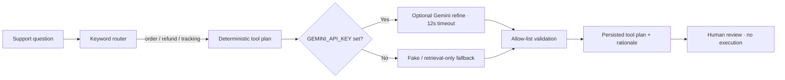

# Tool Plan Desk

Tool Plan Desk is a small Harbor Desk support-operations demo. Paste a fictional customer question and get an ordered recommendation for the support tools that could help: `order_status`, `refund_policy`, and `tracking`. Plans are saved for review; the app never executes a tool or connects to real customer orders.

## AI design

The planner starts with a deterministic keyword router. An optional LLM can refine that plan and add a concise rationale, but its output is filtered through the same tool allow-list and the router's original matches are kept. If Gemini is unavailable, times out, or returns an invalid response, the deterministic plan is returned instead.



`App\Services\Llm\LlmClient` is the provider boundary. The application binds `GeminiLlmClient` only when `GEMINI_API_KEY` is configured; otherwise it uses `FakeLlmClient`. The tests inject the fake and verify routing, allow-list filtering, guest access, and fallback behavior.

## Run locally

Requirements: PHP 8.3+, Composer, and Node 22+ with npm.

```bash
composer install
cp .env.example .env
php artisan key:generate
php artisan migrate --seed
npm install
npm run build
php artisan serve
```

Open [http://localhost:8000](http://localhost:8000). No API key or login is needed. The seed inserts four fictional support questions and their example plans. Without a Gemini key, the app uses the built-in fake client and remains fully usable.

To enable optional Gemini refinement, set `GEMINI_API_KEY` in `.env`. `GEMINI_MODEL` defaults to `gemini-2.5-flash`. Requests have a 12-second timeout and provider failures fall back to the deterministic keyword plan.

## Tests and checks

```bash
composer test
composer ci:check
```

Pest tests prove that order-status and refund questions select their required tools, unknown LLM tools are removed, the fake client is bound when no API key is present, a guest can submit a question, and a provider failure still returns the deterministic plan. Front-end type checking and the production build cover the Vue/Inertia UI.

## Stack

- Laravel 13, PHP 8.3+
- Vue 3 + Inertia.js
- SQLite by default; no Redis
- Optional Gemini API through an interface
